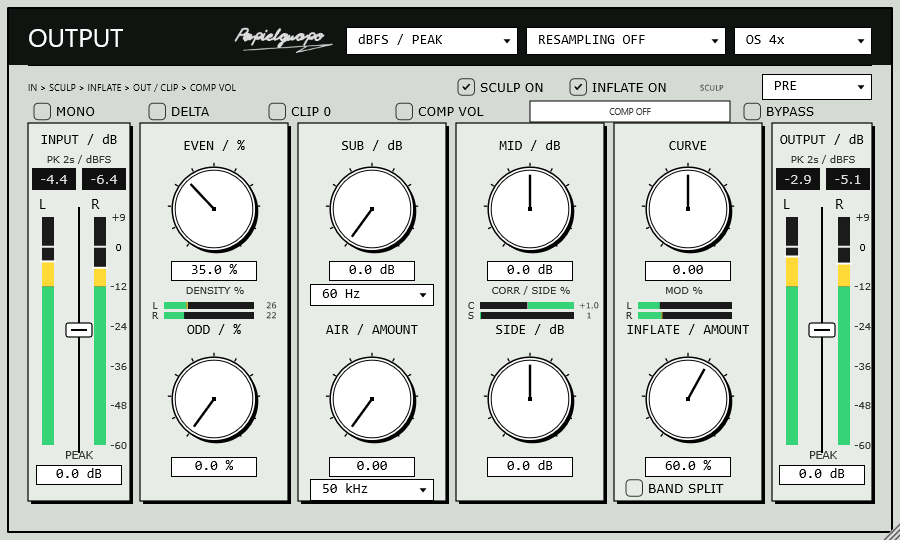
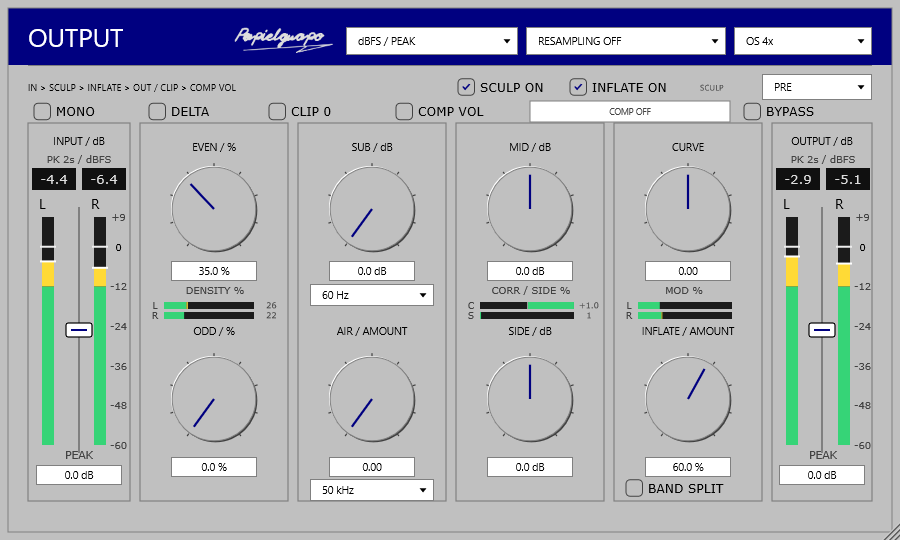

<div align="center">

# 🎛️ OUTPUT - PAPIELGUAPO

**Procesador de Mastering y Bus VST3 / Standalone (64-bit) para Windows con motor SCULP (TMC Fobos 1:1) + INFLATE, Resampling Quality 1:1 de FL Studio (`TResampler`), 18 Skins integradas y compensación automática de volumen post-clip.**  
Creado por **[papielguapo](https://github.com/papielguapo)**.


-7e12d5?style=flat-square)


---

### ATARI PC



### WINDOWS 98



</div>

---

## 🚀 Novedades de la Última Actualización

1. **Menú de Presets de `SCULP` al hacer Clic Derecho en `OUTPUT` (arriba a la izquierda):**
   - **Presets 1:1 de `TMC Fobos` incluidos de fábrica:**
     - `Default (Reset Sculp)` (`Even=0%, Odd=0%, Sub=0 dB @ 60 Hz, Air=0 @ 50 kHz, Mid=0 dB, Side=0 dB, Input=0 dB, Output=0 dB`)
     - `TMC_Mixbus` (`Odd=6%, Sub=2 dB @ 40 Hz, Air=2 @ 50 kHz, Side=+2 dB`)
     - `TMC_Mixbus (Clarity)` (`Odd=12%, Sub=1 dB @ 40 Hz, Air=1 @ 50 kHz, Side=+2 dB`)
     - `TMC_Mixbus (Density)` (`Even=9%, Sub=2 dB @ 40 Hz, Air=0 @ 55 kHz, Side=+2 dB`)
     - `TMC_Mixbus (MachineHead)` (`Odd=10%, Sub=0 dB @ 100 Hz, Air=4 @ 55 kHz, Output=-2 dB`)
     - `TMC_Mixbus (MixHead)` (`Odd=10%, Sub=0 dB @ 100 Hz, Air=3 @ 65 kHz, Output=-2 dB`)
     - `TMC_Trans_sienten` (`Even=100%, Sub=10 dB @ 40 Hz, Air=3 @ 55 kHz, Mid=+10 dB, Input=-10 dB, Output=-1.6 dB`)
   - **Gestión completa de Presets de Usuario (`USER SCULP PRESETS`):** Permite **guardar** nuevos presets personalizados, **cargar**, **sobrescribir**, **eliminar** y abrir directamente la carpeta `Documents\papielguapo\OUTPUT\Presets`.

2. **18 Skins Seleccionables haciendo Clic Derecho en la firma `papielguapo`:**
   - El selector de skins se abre con **clic derecho sobre la firma `papielguapo`** en la cabecera, liberando espacio para los selectores de audio.
   - Abre por defecto con la nueva skin **`ATARI PC`** en tamaño compacto (`450 × 270 px`), reescalable continuamente hasta `1350 × 810 px`.
   - **Lista completa de 18 skins incluidas:**
     - **OUTPUT Skins:** `BLACK`, `DIAMOND II`, `Ads`
     - **DAW & Retro Skins:** `FL STUDIO`, `FL DARK`, `ABLETON LIVE`, `LOGIC PRO X`, `PRO TOOLS`, `MAGIX SEQUOIA`, `ADOBE AUDITION`, `CUBASE 14`, `REAPER 7`, `WINAMP CLASSIC`, `ATARI PC` *(Default)*, `WINDOWS 98`, `MAC OS X AQUA`, `BLACK STEALTH`, `WHITE STUDIO`.

3. **Motor de Resampling Quality de FL Studio (`FLResamplingQuality`) + `Native Daw` en Cabecera:**
   - Situado en la barra superior entre `I/O SCALES` y `OVERSAMPLING`:
     - `RESAMPLING OFF` (bypass del resampler)
     - `Native Daw` (deja actuar únicamente el motor nativo del DAW sin alterar la señal ni añadir latencia)
     - **Low quality / fastest:** `2-point linear`, `6-point Hermite`
     - **Average quality:** `16-point sinc`, `24-point sinc`, `32-point sinc`
     - **High quality / slowest:** `64-point sinc`, `128-point sinc`, `256-point sinc`, `512-point sinc`

4. **Nueva Ruta de Señal y Disposición de Controles (`IN > SCULP > INFLATE > OUT / CLIP > COMP VOL`):**
   - **`COMP VOL` actúa detrás de `CLIP 0`** en la cadena DSP: primero se aplica el recorte a `0 dBFS` (`CLIP 0`) y después `COMP VOL` mide y compensa el volumen respecto a la entrada original.
   - **Fila de botones superior:** `MONO` · `DELTA` · `CLIP 0` · `COMP VOL` · `[Indicador COMP OFF / dB]` · `BYPASS`.
   - **Cabecera unificada:** `I/O SCALES` (`dBFS / PEAK`, `LINEAR / RMS`, `VU -18`, `K-12`, `K-14`, `K-20`, `SCULP SWEET SPOT`) + `RESAMPLING` + `OVERSAMPLING` (`OS 1x / OFF`, `OS 2x`, `OS 4x`, `OS 8x`).

---

## 🎚️ Arquitectura y Módulos DSP

**OUTPUT** divide su procesamiento en seis columnas modulares con medición en tiempo real:

1. **`INPUT / dB`:** Ganancia de entrada (`-24 dB` a `+24 dB`) con medidores estéreo independientes `L/R`, retención de picos de 2 segundos (`PK 2s`) e indicador de sobrecarga (`OVER`). Haz clic sobre las cajas numéricas de pico para limpiar retenciones.
2. **`EVEN / %` & `ODD / %` (con medidor `DENSITY %` L/R):** Generación de armónicos pares (2º orden, calidez asimétrica) e impares (3er orden, pegada simétrica), con medidor integrado de contribución no lineal relativa promediada a 300 ms.
3. **`SUB / dB` & `AIR / AMOUNT`:**
   - `SUB`: Realce de graves con frecuencias seleccionables (`20 Hz`, `40 Hz`, `60 Hz`, `100 Hz`) y transiciones suaves libres de clics de 20 ms (soportando giro con rueda de ratón).
   - `AIR`: Shelf ultrasónico de alta frecuencia (`50 kHz`, `55 kHz`, `60 kHz`, `65 kHz`).
4. **`MID / dB` & `SIDE / dB` (con medidores `C` y `S`):** Matriz Mid/Side con medidor de correlación de fase L/R (`C`, de `-1` a `+1` con rechazo DC a 5 Hz) y porcentaje de energía lateral (`S`, `0%` mono a `100%` antifase).
5. **`CURVE` & `INFLATE / AMOUNT` (con medidor `MOD %` y `BAND SPLIT`):** Etapa de densidad y modelado dinámico wave-shaping con opción multibanda (`BAND SPLIT`) y selector de orden `PRE` / `POST` respecto a `SCULP`.
6. **`OUTPUT / dB`:** Ganancia de salida final, `CLIP 0`, compensación automática RMS (`COMP VOL` post-clip con espera de 500 ms, subida máxima de 2 dB/s y retorno automático a 0 dB bajo `-60 dBFS`) y botón `BYPASS` global con fundido suave.

---

## 📦 Instalación en Windows (x64)

1. Copia el bundle **`OUTPUT.vst3`** (incluido en la raíz del repositorio y en `Binaries/OUTPUT.vst3`) a tu carpeta de plugins VST3 del sistema:
   - `C:\Program Files\Common Files\VST3\OUTPUT.vst3`
   - o `C:\ProgramData\Common Files\VST3\OUTPUT.vst3`
2. También puedes ejecutar el script **`Install.ps1`** con PowerShell como Administrador.
3. Para usar la versión independiente sin DAW, ejecuta **`Binaries/OUTPUT.exe`**.

---

## 🛠️ Compilación desde el Código Fuente

Requisitos: **CMake 3.22+**, **Visual Studio 2022 / 2026 (MSVC x64)** y **JUCE 9.0.4**:

```powershell
cmake -S . -B build -G "Visual Studio 18 2026" -DPHOBOS67_JUCE_PATH="C:/ruta/a/JUCE"
cmake --build build --config Release --target Phobos67_VST3 Phobos67_Standalone Phobos67Check --parallel
```

---

## 📄 Licencia

Distribuido bajo licencia **GNU Affero General Public License v3.0 (AGPL-3.0)**. Consulta el archivo [`LICENSE`](LICENSE) para más detalles.
